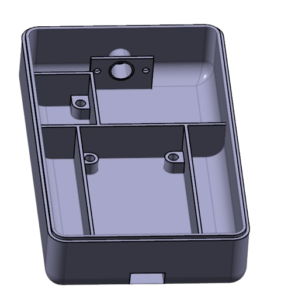
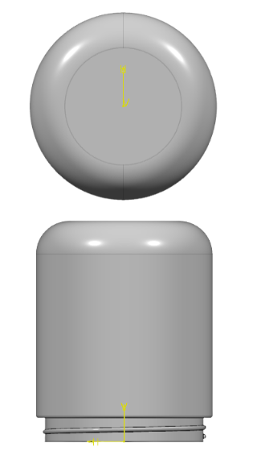

# Luminos — Gesture-Controlled Smart Lighting

Control three LED lanterns with a wearable motion controller: tilt to change color or white-light intensity, and make a sudden movement to toggle the lights.

Luminos is a university group engineering prototype from the International School of Engineering, Chulalongkorn University. Its project report is titled *Luminos: a Doctor Strange Inspired Device*.

**Repository status:** Documentation prepared from the seven-page group report. Original firmware, editable CAD, standalone circuit files, prototype photographs, and test logs have not been supplied. Historical code transcriptions and an explicitly labeled AI-generated reference implementation are now available in [firmware](firmware/README.md). The generated version is not the original team firmware and has not been tested on the project hardware.

## How it works

The wearable ESP32 reads an MPU6050 motion sensor over I²C. Acceleration along the x-axis identifies tilts; changes in total acceleration identify sudden motion. The controller translates gestures into NEC infrared commands. Each lantern uses an ESP32, four IR receivers for wider angular coverage, and a 16-pixel NeoPixel ring.

The final report describes 38 kHz infrared signaling. The February progress reports also contain early Wi-Fi dashboard and relay-control examples; these are preserved as historical transcriptions in the firmware folder. They do not establish a completed dashboard integrated with the final IR/NeoPixel system.

## Gesture controls

- **Tilt right → command 1:** Change LED color.
- **Tilt left → command 2:** Change white-light intensity.
- **Sudden motion → command 3:** Toggle lighting on/off.
- **Neutral → no command:** Preserve the current lighting state.

These command numbers come from the report; complete NEC addresses, frame values, gesture thresholds, repeat handling, and brightness steps are not supplied.

## Engineering highlights

- A wearable controller and three lanterns demonstrate gesture-based lighting control.
- Four receivers per lantern improve reception from different directions; infrared still depends on a usable optical path.
- The wearable enclosure separates electronics and battery components and includes mounting features and strap slots.
- The lantern design uses a threaded head and base, receiver openings, and internal receiver supports.
- The team investigated interference attributed to the wearable's step-up booster and revised the power arrangement.

## Source code and reference firmware

[Browse firmware, provenance, build instructions, and tests](firmware/README.md). Readable screenshots from the early progress reports are transcribed separately from newly generated code. The generated ESP32 wearable/lantern example implements the final report's MPU6050 and NEC commands 1/2/3 with configurable defaults; the original final integrated source is still unavailable. Do not attribute generated code to the project team or use its selected parameters as historical measurements.

## CAD design previews

The wearable controller and lantern housings were designed with internal mounting, component compartments, and receiver openings. These illustrations are extracted from the group report.

[View all eight CAD illustrations with source captions](docs/cad-gallery.md). Editable CAD files have not been supplied.

## Reported results and limits

The group report describes successful color changes, white-level adjustment, and on/off toggling. It reports response latency **under 100 ms** and improved angular coverage from multiple receivers. These are report claims, not independently reproduced measurements: no raw timing data, trial counts, measured coverage angles, or range results were supplied.

The report's early circuit and later implementation differ. The exact final power circuit, IR emitter drive circuit, receiver interconnection, and board pin mapping need confirmation before a build guide can be published. See [hardware notes](docs/hardware.md) and [validation notes](docs/validation.md).

## Mathas Tiranaprakij's contributions

Mathas's individual contribution scope, carried forward from the supplied project context, comprises:

- CAD design of hardware enclosures.
- Hardware assembly and integration.
- IR sensor wiring and connections.
- Programming IR communication.
- Testing IR transmission and reception.
- Designing IR sensor placement.

These contributions are part of the group's overall system. This attribution does not claim sole authorship of the firmware, gesture recognition, LED control, every CAD component, or the full prototype. The report lists authors but does not assign individual tasks; exact file ownership and teammates' roles should be reviewed with the group. See [credits and attribution](docs/credits.md).

## Documentation

- [CAD design gallery](docs/cad-gallery.md)
- [System and hardware notes](docs/hardware.md)
- [Reported results and future validation](docs/validation.md)
- [Credits and contribution boundaries](docs/credits.md)
- [Source provenance and open questions](docs/source-notes.md)

The [seven-page project report](docs/report/luminos-project-report.pdf) is included with group permission, as confirmed by Mathas. It contains the original CAD and circuit figures; CAD illustrations are also available in the gallery above. Editable originals are not included.

## Future development

The report proposes filtering sensor noise, using more motion axes, improving power management, strengthening command validation, adding lighting effects, and integrating electronics onto a custom PCB. These are proposed extensions, not implemented features established by the supplied material.

## Sharing and licensing

Mathas confirmed on 5 November 2026 that the group approved publication and gave permission. No open-source license has been selected or granted by this documentation package. Agree on licenses for documentation, code, and hardware design files before adding a license; publication permission does not itself specify a reuse license.
