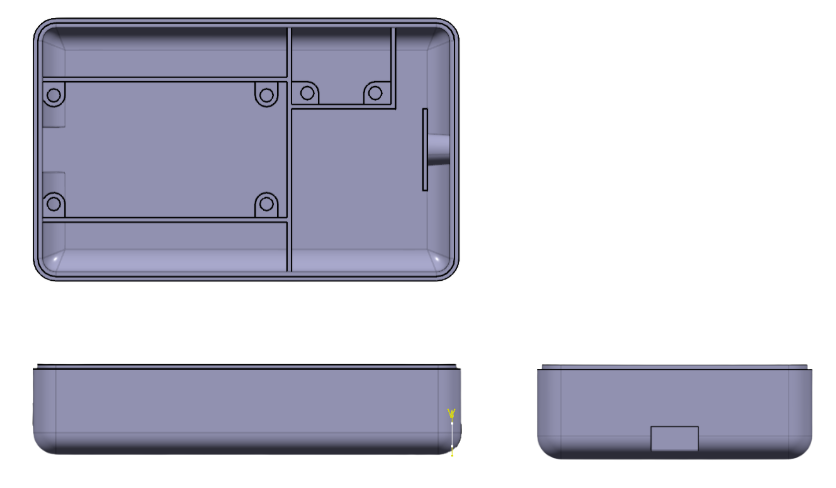
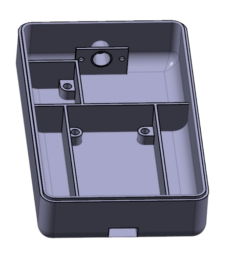
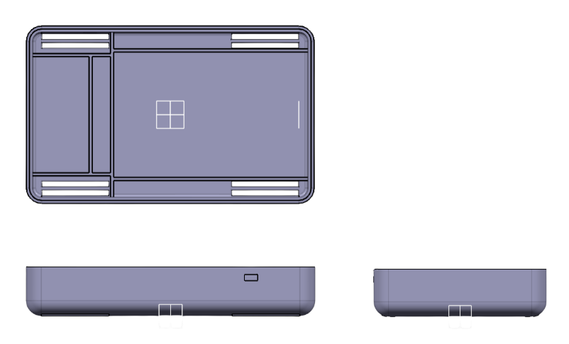
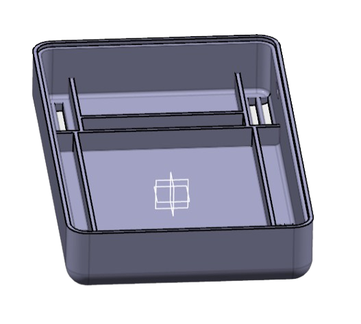
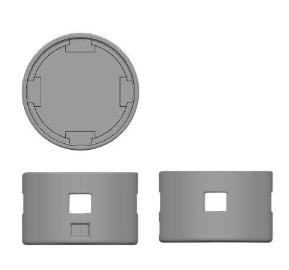
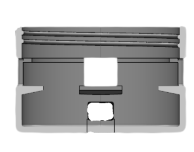
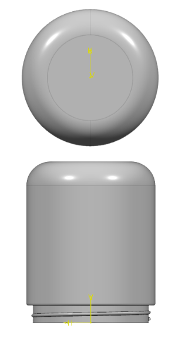
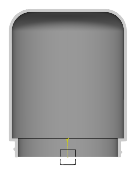

# CAD design gallery

These eight images were extracted from the approved group report, *Luminos: a Doctor Strange Inspired Device*. They are report illustrations, not editable CAD models or fabrication-ready files. Credit belongs to the project team; Mathas's confirmed individual scope is recorded in [credits](credits.md).

Source: [project report](report/luminos-project-report.pdf), pages 4–5. Original image resolution is preserved. Figure 10 is captioned as a base in the report, but depicts the lantern head; the filename below describes the visible part.

## Wearable enclosure views

Source: Figure 3, page 4.

## Wearable enclosure interior

Source: Figure 4, page 4.

## Wearable base views

Source: Figure 5, page 4.

## Wearable base interior

Source: Figure 6, page 4.

## Lantern base views

Source: Figure 8, page 5.

## Lantern base cross-section

Source: Figure 9, page 5.

## Lantern head views

Source: Figure 10, page 5.

## Lantern head cross-section

Source: Figure 11, page 5.

