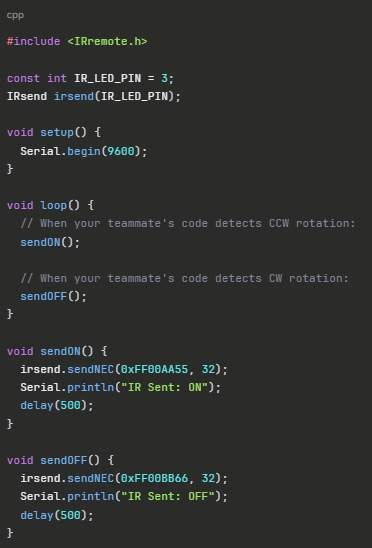
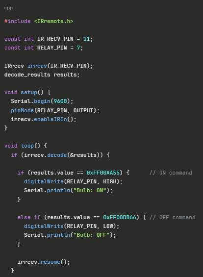
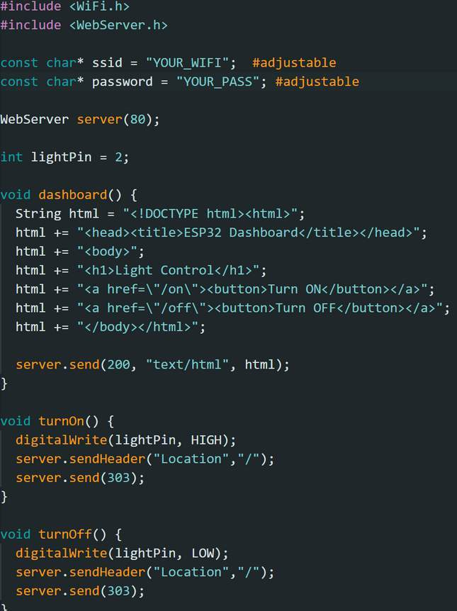
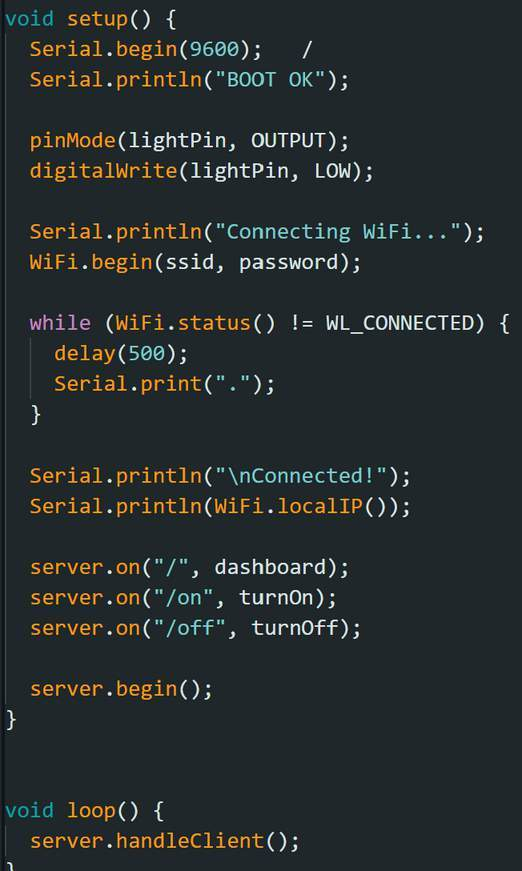

# Luminos firmware: historical examples and generated reconstruction

## What is original evidence, and what is generated?

- `historical-ir.txt`: manual transcription of the transmitter/receiver screenshots on page 12 of Progress Report 1, dated 10 February 2026. Early ON/OFF relay examples, not final NeoPixel firmware. Legacy APIs and pins are preserved as evidence.
- `historical-dashboard.txt`: manual transcription of visible code on page 15 of that report. Invalid annotations and clipped braces are explicitly identified. This is a local-GPIO Wi-Fi example, not proof of an integrated network system.
- `main.cpp`, `logic.h`, `platformio.ini`, `test_logic.cpp`: **AI-generated reference reconstruction on 6 November 2026**, requested by Mathas to fill missing implementation. These are not the team's original firmware and are not evidence of individual authorship or historical performance.

Progress Report 2, dated 17 February 2026, describes ADXL345 roll-angle detection with a reference angle, 90-degree trigger, and neutral rearm. Its code is only visible in blurred laptop photographs; a reliable verbatim transcription is not possible. The final report instead identifies MPU6050, NEC commands 1/2/3, and NeoPixel rings. The generated implementation targets that final architecture; it does not pretend the two sensor versions are identical.

## Generated behavior

Build one wearable and one or more lanterns from the same project. The wearable reads MPU6050 acceleration every 20 ms. A positive x acceleration over 5 m/s² held for 150 ms changes color; a negative value below -5 changes white level. Return within ±2.5 m/s² to rearm. A change in total acceleration above 35 m/s³ sends toggle, with a 600 ms cooldown. Mounting orientation determines which physical direction is positive; verify it before use. These values are selected defaults, not recovered thresholds.

The generated NEC address is `0x4C55`; commands are 1=color, 2=white, 3=toggle. No legacy raw ON/OFF frame compatibility is promised. The receiver accepts only NEC frames with this address and valid command, rejects repeats/parity failures/overflow. It applies each valid non-repeat command without a blanket timing gate, so a shake immediately after a tilt is preserved. Light state starts off; color/white commands update the saved mode while off, and toggle makes it visible. Six colors and four white levels are selected examples. No multi-lantern acknowledgment or synchronization protocol is implemented; IR packet loss can leave lantern states different.

## Generated wiring defaults — verify against your hardware

Wearable: ESP32 GPIO26 for the IR drive signal; I²C SDA21/SCL22 for MPU6050. Lantern: GPIO27 for a receiver's demodulated output; GPIO25 for a 16-pixel NeoPixel ring data input. These pins differ from historical screenshots and have not been checked against your assembled device. Board target is the generic classic ESP32 `esp32dev`.

This reference uses **one receiver input**. The report's four-module output interconnection is unresolved; do not directly parallel module outputs based on this firmware. It needs a verified combining circuit or separately implemented inputs. Verify receiver output voltage, LED data-level requirements, component current limiting, common ground, and the final power circuit. The firmware does not validate the report's direct-battery-to-Vin revision. An IR LED requires an electrically suitable drive circuit; GPIO26 is a control signal, not a guarantee that an LED can be connected directly.

Brightness is capped at 64/255 in the generated example, but actual power requirements must still be established. No mains switching is implemented. Wi-Fi dashboard code remains historical evidence; it is not enabled in the generated build.

## Build

Install PlatformIO Core or its editor extension, open a terminal in this `firmware` folder, then:

```text
pio run -e wearable
pio run -e lantern
```

Dependencies are pinned in `platformio.ini`: Espressif32 platform 6.12.0, Arduino-IRremote 4.4.1, Adafruit MPU6050 2.2.6, Unified Sensor 1.1.15, BusIO 1.17.2, and NeoPixel 1.12.5. Only `main.cpp` is built; the two historical `.txt` files are excluded.

After checking the board and wiring, attach the intended board and use `pio run -e wearable -t upload` or `pio run -e lantern -t upload`. Use the matching environment; uploading replaces the board's existing firmware. Serial monitor baud is 115200.

## Host tests

With a C++17 compiler, from this folder:

```text
g++ -std=c++17 -Wall -Wextra -pedantic test_logic.cpp -o test_logic
./test_logic
```

On Windows run `test_logic.exe`. Tests cover tilt dwell/rearm, shake cooldown, invalid samples, data gaps, clock wrap, command rejection, saved light modes, and cycling. Host logic tests and successful compilation do not establish physical gesture accuracy, electrical correctness, IR range, or latency. No hardware tests have been performed for this reconstruction.

Upstream API references: [Arduino-IRremote](https://github.com/Arduino-IRremote/Arduino-IRremote), [Adafruit MPU6050](https://github.com/adafruit/Adafruit_MPU6050), [PlatformIO Espressif32](https://docs.platformio.org/en/latest/platforms/espressif32.html).


## Verification on 6 November 2026

Both PlatformIO environments (`wearable`, `lantern`) compiled successfully with the pinned dependencies. The C++17 host tests passed, including a color command followed by toggle 20 ms later. Receiver protocol/address/flag filtering was inspected and compiled, but is not exercised by the host tests. No board was flashed and no hardware performance was measured. On Windows, use a short project/toolchain path if the compiler reports `CreateProcess` errors with long paths.

## Original screenshot evidence








